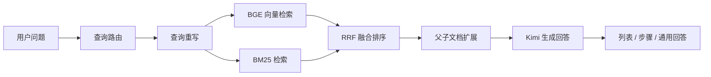

# 尝尝咸淡 RAG

一个独立运行的菜谱知识库问答项目。

项目将中文菜谱整理成结构化知识库，在本地完成文本切分、向量化和混合检索，
再结合 Kimi 为用户推荐菜品、查找食材并生成详细烹饪步骤。


## 项目简介

面对“今天吃什么”“这道菜需要什么食材”“具体怎么做”这类问题，传统关键词搜索
容易漏掉语义相关的内容，普通大模型又可能给出不准确或缺少依据的回答。

尝尝咸淡 RAG 把菜谱知识库和生成模型连接起来，通过父子文本块、BGE 向量检索、
BM25 关键词检索和 RRF 融合，让回答既具备检索到的真实菜谱依据，也能以自然语言
呈现制作过程。

## 核心能力

- **菜谱问答**：查询具体菜品、食材、用量和制作步骤。
- **菜品推荐**：按分类、难度和饮食需求推荐菜品。
- **混合检索**：结合语义向量检索与 BM25 关键词检索。
- **父子文档**：使用小块精确定位，再用完整菜谱生成回答。
- **元数据过滤**：支持荤菜、素菜、汤品、主食、甜品等分类。
- **索引缓存**：首次构建 FAISS 索引，后续启动直接复用。
- **流式回答**：在命令行中实时展示生成内容。

## 系统流程



## 项目结构

```text
.
├── code/C8/
│   ├── main.py                     # 应用入口
│   ├── config.py                   # 模型、路径与检索配置
│   ├── requirements.txt
│   └── rag_modules/
│       ├── data_preparation.py     # 菜谱加载、分块与元数据
│       ├── index_construction.py   # BGE + FAISS 索引
│       ├── retrieval_optimization.py
│       └── generation_integration.py
├── data/C8/cook/dishes/            # 323 份 Markdown 菜谱
├── .github/workflows/ci.yml
└── .env.example
```

## 快速开始

### 1. 获取项目

```bash
git clone https://github.com/Noah896/all-in-rag.git
cd all-in-rag
```

### 2. 创建 Python 环境

```bash
python -m venv .venv
```

Windows PowerShell：

```powershell
.\.venv\Scripts\Activate.ps1
```

Linux 或 macOS：

```bash
source .venv/bin/activate
```

### 3. 安装依赖

```bash
pip install -r code/C8/requirements.txt
```

### 4. 配置 API Key

复制环境变量模板：

```powershell
Copy-Item .env.example .env
```

编辑 `.env`，填写 Moonshot API Key：

```dotenv
MOONSHOT_API_KEY=your_moonshot_api_key
```

API Key 可在 [Moonshot 开放平台](https://platform.moonshot.cn/console/api-keys) 创建。

### 5. 启动项目

```bash
python code/C8/main.py
```

首次启动会加载嵌入模型并构建向量索引。索引生成后保存在
`code/C8/vector_index`，后续启动会自动复用。

## 使用示例

```text
您的问题: 宫保鸡丁怎么做？
查询类型: detail

为您生成菜品介绍、所需食材、制作步骤和烹饪技巧。
```

```text
您的问题: 推荐几道简单的素菜
查询类型: list

1. 西红柿炒鸡蛋
2. 酸辣土豆丝
3. 蒜蓉西兰花
```

可以直接尝试：

- 红烧肉需要哪些食材？
- 推荐几道适合新手的菜。
- 今天有什么容易做的汤？
- 糖醋排骨的步骤是什么？

## 嵌入模型

项目默认使用 `BAAI/bge-small-zh-v1.5`。首次运行时需要联网从 Hugging Face
下载，也可以提前准备本地模型：

```text
models/bge-small-zh-v1.5/
code/C8/models/bge-small-zh-v1.5/
```

本地目录至少需要包含 `config.json`，以及 `model.safetensors` 或
`pytorch_model.bin`。

完全离线运行时，在 `.env` 中添加：

```dotenv
HF_HUB_OFFLINE=1
TRANSFORMERS_OFFLINE=1
```

如需使用 Hugging Face 镜像：

```dotenv
HF_ENDPOINT=https://hf-mirror.com
```

## 配置说明

核心配置位于 `code/C8/config.py`：

| 配置项 | 默认值 | 说明 |
| --- | --- | --- |
| `data_path` | `data/C8/cook` | 菜谱知识库 |
| `index_save_path` | `code/C8/vector_index` | FAISS 索引目录 |
| `embedding_model` | `BAAI/bge-small-zh-v1.5` | 向量嵌入模型 |
| `llm_model` | `kimi-k2.6` | 回答生成模型 |
| `top_k` | `3` | 最终返回检索结果数量 |
| `temperature` | `1.0` | Kimi K2.6 支持的生成温度 |

## 开发与检查

运行代码语法检查：

```bash
python -m compileall -q code/C8
```

当前知识库包含 323 份菜谱，结构化分块后可生成约 1,764 个可检索文本块。

## 安全与版本管理

- `.env`、API Key 和本地模型不会进入 Git。
- FAISS 索引属于运行产物，不提交到仓库。
- 如需新增配置项，请同步更新 `.env.example` 和 README。
- 如果密钥曾经进入提交历史，应立即撤销并重新生成。

## 数据说明

项目使用 Markdown 作为知识库格式，RAG 流程只读取文本内容。
